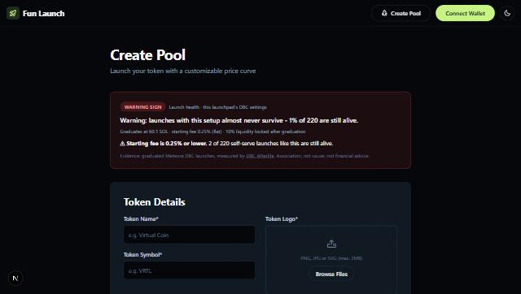

# Launch health for Meteora's fun-launch scaffold

A drop-in for [meteora-invent/scaffolds/fun-launch](https://github.com/MeteoraAg/meteora-invent/tree/main/scaffolds/fun-launch)
(tested on commit `dd77ef3`). It reads the launchpad's own DBC config (`POOL_CONFIG_KEY`) from chain and shows
creators, right above the token form, how graduated launches with the same settings fared.

| Settings that match a proven pattern | Settings with a warning sign |
|---|---|
|  |  |

Left: the Steady preset, created on devnet with `devnet.ts`. Right: a real mainnet config with a 0.25% fee.

## Install (3 files + 2 lines)

1. Copy `src/lib/afterlife/`, `src/pages/api/launch-health.ts` and `src/components/LaunchHealth.tsx` into the
   scaffold's `src/`.
2. Apply `create-pool.patch` (an import and `<LaunchHealth />` above the token form):
   `git apply create-pool.patch` from the meteora-invent root.
3. Nothing new to configure: it uses the scaffold's existing `RPC_URL` and `POOL_CONFIG_KEY`. Optional:
   `AFTERLIFE_EVIDENCE_URL` (defaults to the held-out evidence published at
   `https://snit292012.github.io/dbc-afterlife/data/evidence_test.json`).

## Behaviour

- `GET /api/launch-health` decodes the config with the DBC SDK and returns a verdict (cached 10 minutes).
- The badge is informational. If the check fails (RPC or evidence unavailable) it hides itself and never
  blocks the form.
- Operators can also gate deployments: `npx tsx check.ts --strict <config address>` in the main repo exits
  with code 2 on a red verdict.

`src/lib/afterlife/` is a copy of `rules.ts` and `checker.ts` from the repo root; `npm test` fails if they drift.
